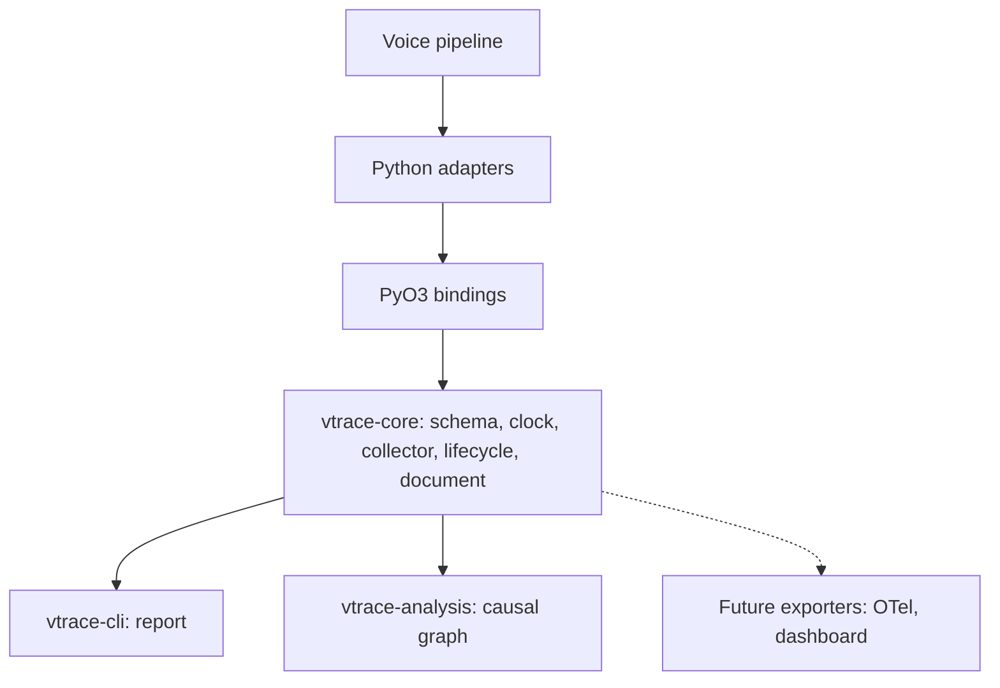

# vTrace Specification 0001 — System Overview

- **Status:** Accepted
- **Date:** 2026-10-16
- **Related decisions:** [0001 (runtime strategy)](../decisions/0001-language-and-runtime-strategy.md), [0006 (trace document as contract)](../decisions/0006-trace-document-as-contract.md)
- **Supersedes (content):** former RFC-0001 (architecture), folded here by migration

## 1. Purpose

Define what vTrace is, what it observes, and the single question every other
spec serves.

## 2. Problem statement

A real-time voice AI turn is asynchronous, concurrent, and streaming. A
single end-to-end latency number cannot explain where time is spent. vTrace
must reconstruct an ordered event timeline and identify, with valid
evidence, the runtime components that introduce avoidable latency between
the end of user speech and the first audible response.

## 3. Key concepts

- **Voice turn**: one user utterance and the assistant's response, including
  retries and interruption.
- **Timeline**: an ordered sequence of timestamped events (not a sum of
  durations).
- **Causal graph**: a DAG of explicit dependency edges, never inferred
  from temporal proximity (decision 0005).
- **Trace document**: the JSON contract between collector, CLI, and future
  consumers (decision 0006).
- **Critical path**: the dependency chain that determines a given latency
  objective; distinct per objective.

## 4. Functional requirements

- vTrace MUST observe execution without altering application semantics
  (invariant 1).
- vTrace MUST reconstruct a complete voice-turn timeline from collected
  events.
- vTrace MUST distinguish compute, queue wait, scheduling delay, and
  streaming overlap.
- vTrace MUST track cancellation request, acknowledgement, and
  completion as separate events.
- vTrace MUST NOT record raw audio, transcripts, prompts, or model
  responses by default (decision 0004).
- vTrace MUST export a trace document validatable against
  `docs/schema/trace.schema.json`.
- vTrace MUST report incomplete traces explicitly (invariant 10).

## 5. Non-functional requirements

- **Correctness** first, then measurement validity, real-time safety,
  reproducibility, developer experience, performance (in that order).
- Instrumentation MUST NOT block the audio hot path.
- The collector MUST be bounded in memory.

## 6. Technical design

### Rust layer table (enforced by `cargo xtask layers`)

| Layer | Crate | Role | May depend on |
|---|---|---|---|
| L0 | `vtrace-core` | Schema, clock, bounded collector, lifecycle, document | no workspace crate |
| L1 | `vtrace-analysis` | Explicit-edge DAG, per-objective critical paths | `vtrace-core` |
| L2 | `vtrace-python` | PyO3 bindings | `vtrace-core`, `vtrace-analysis` |
| apps | `vtrace-cli` | `vtrace report` | `vtrace-core` |

Nothing below L2 MAY depend on PyO3 or Python. `cargo xtask layers`
MUST fail the build on a violation.

### Module responsibilities

| Module | Responsibilities | Public interface |
|---|---|---|
| Event model | Canonical event names and families | Catalog (spec 0003) |
| Clock abstraction | Monotonic + manual clocks, domains | `Clock`: `now_ns()`, `domain()` (spec 0004) |
| Event collector | Bounded, non-blocking ingestion | `record()`, `export()`, `shutdown()` (spec 0005) |
| Lifecycle tracker | Transition validation | Turn/task state machine (spec 0006) |
| Causal graph | DAG from explicit edges | `build_graph(document)` (spec 0007) |
| Critical path analyzer | Per-objective paths | `critical_path(document, objective)` (spec 0007) |
| CLI | Text report from a document | `vtrace report <file>` |

## 7. Contracts and data structures

The public contract is the **trace document** (decision 0006). All
consumers depend on the document, not on internal objects. The
machine-readable schema is `docs/schema/trace.schema.json` (spec 0003).

## 8. Invariants

1. Instrumentation MUST NOT alter application semantics.
2. Local duration measurement MUST use compatible monotonic clocks
   within one clock domain.
3. Event buffers MUST be bounded.
4. Event loss MUST be observable.
5. Critical-path conclusions require valid dependency evidence.
6. Cancellation requested does not imply cancellation completed.
7. Terminal-state transitions MUST be validated.
8. Raw audio and transcripts MUST NOT be recorded by default.
9. Every performance claim MUST reference reproducible measurements.
10. Incomplete traces MUST be explicitly identified.

Each invariant is testable; see spec 0008.

## 9. Failure modes

- Collector blocks the audio path. Mitigation: non-blocking `record()`.
- Export depends on live objects. Mitigation: flat JSON document.
- A Rust migration breaks the contract. Mitigation: `i64` ns +
  `clock_domain` string at the FFI, never a raw `Instant`.
- Adapters become mandatory. Mitigation: core tests without adapters.

## 10. Test and acceptance criteria

- A replayable fixture produces a deterministic document
  (`fixtures/traces/one-turn.json`).
- The document validates against the schema.
- `cargo xtask layers` is green.
- `cargo xtask ci` is green.

## 11. Alternatives considered

- **Python-only**: rejected (decision 0001) — the user chose a Rust core
  from P1 for a single strongly-typed implementation.
- **Rust only, no Python**: rejected — Python is the adapter and
  Hugging Face integration surface.
- **Two independent implementations**: rejected — breaks the single
  contract guarantee (decision 0006).

## 12. Open questions

- Does the public Python API stabilize at P1 or P2? Suggested: P2.
- Should `vtrace-analysis` be a separate crate or a module of
  `vtrace-core`? Decidable at P4.
