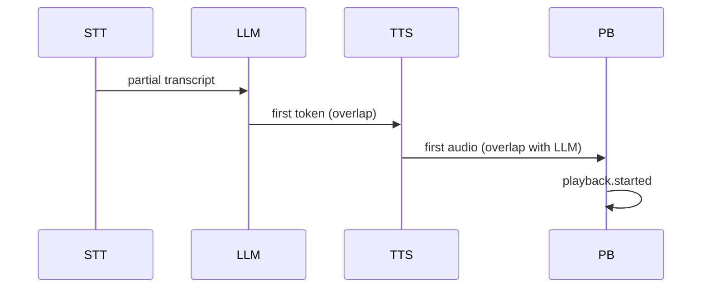

# vTrace Specification 0002 — Audio Streaming Model

- **Status:** Proposed
- **Date:** 2026-10-16
- **Related decisions:** [0004 (privacy default)](../decisions/0004-privacy-default.md)
- **Depends on:** [0001 (overview)](0001-system-overview.md)

## 1. Purpose

Define the audio and streaming concepts vTrace must measure, and the
measurement boundaries that matter for perceived latency.

## 2. Problem statement

The time an audio chunk is generated, the time it is delivered to the
output device, and the time it becomes audible are three distinct
instants. A profiler that conflates them answers the wrong question.
Device-level audibility is not always directly observable.

## 3. Key concepts

- **Sample rate / frame / buffer**: PCM frames, channel layouts, buffer
  sizes, ring buffers, audio callbacks, underflow/overflow.
- **Audio callback**: MUST NOT block, allocate in steady state, or panic.
- **Playback scheduling**: the device consumes buffers at its own cadence;
  the application enqueues ahead of time.
- **Streaming chunk**: a unit of audio emitted by a producer (STT
  partial, LLM token, TTS chunk).
- **Producer-consumer overlap**: downstream stages may start before
  upstream finishes.
- **Three boundaries**: first generated audio, first submitted to the
  output device, first audible playback.

## 4. Functional requirements

- vTrace MUST define events for `tts.first_audio` (first synthesized
  chunk), `playback.buffered`, and `playback.started` (effective
  playback start).
- vTrace MUST NOT treat these three as equivalent.
- `playback.started` MUST be emitted only when a playback hook confirms
  effective start; vTrace MUST NOT infer it from submission.
- When no playback hook exists, `time_to_audible` MUST be `unavailable`,
  not substituted with `tts.ttfa`.

## 5. Non-functional requirements

- Audio-path instrumentation MUST NOT allocate, lock contended locks,
  or encode JSON on the callback thread.
- `record()` MUST timestamp on the caller's thread before any queue.

## 6. Technical design

### Measurement boundaries

| Boundary | Event | Meaning |
|---|---|---|
| First synthesized audio | `tts.first_audio` | first chunk produced by TTS |
| First submitted audio | `playback.buffered` | first chunk handed to the output path |
| First audible audio | `playback.started` | effective playback start, if observable |

### Streaming overlap

The minimum instrumentation to show that streaming reduces latency:
the `*.started`/`*.first_*`/`*.completed` events per stage plus the
queue handoff timestamps (spec 0005).

## 7. Contracts and data structures

Audio-specific attributes (non-sensitive): `sample_rate`, `channels`,
`chunk_samples`, `backend`. Audio content (PCM samples) MUST NOT be
recorded (decision 0004).

## 8. Invariants

- The audio callback MUST NOT be on the collector's hot path.
- `tts.first_audio`, `playback.buffered`, `playback.started` MUST be
  distinct events with non-decreasing timestamps when present.
- No audibility claim without a `playback.started` event.

## 9. Failure modes

- No playback hook: `time_to_audible` is `unavailable`, not a guess.
- Callback blocks on `record()`: mitigation, non-blocking `try_push`.
- Underflow delays playback: `playback.started` reflects the real
  start, including the delay; vTrace reports it, does not correct it.

## 10. Test and acceptance criteria

- A fixture with overlapping STT/LLM/TTS intervals produces a timeline
  where intervals overlap (start/end ordered, not nested).
- A fixture without `playback.started` yields `time_to_audible =
  unavailable`.

## 11. Alternatives considered

- **Infer audibility from submission**: rejected — not evidence
  (decision 0005).
- **Record audio content**: rejected (decision 0004).

## 12. Open questions

- Is a device-side playback timestamp available on the target platforms?
  Decidable at P5 (Hugging Face integration).
