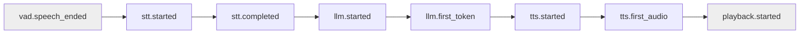

# vTrace Specification 0007 — Causal Graph and Critical Path

- **Status:** Accepted
- **Date:** 2026-10-16
- **Related decisions:** [0005 (no inferred causality)](../decisions/0005-no-inferred-causality.md)
- **Depends on:** [0003 (event schema)](0003-event-schema.md), [0006 (lifecycle)](0006-lifecycle-and-cancellation.md)

## 1. Purpose

Define how vTrace builds a causal dependency graph from a trace and
computes critical paths per latency objective, with explicit handling
of incomplete evidence.

## 2. Problem statement

A timeline is an ordered list of events; a causal graph is a DAG of
dependencies. Summing stage durations is wrong because stages overlap.
Inferring edges from temporal proximity is wrong because proximity is
not causation. vTrace MUST distinguish timeline from DAG and MUST
report uncertainty instead of fabricating a path.

## 3. Key concepts

- **DAG**: directed acyclic graph of explicit edges.
- **Explicit edge**: `parent_id` link, `queued`/`started` pair,
  producer-consumer handoff (with `queue.*` events), cancellation pair.
- **Synchronization point**: a join where multiple producers feed one
  consumer.
- **Critical path**: the longest dependency chain for a given objective.
- **Confidence**: `complete` | `partial` | `unavailable` per path.

## 4. Functional requirements

- The analyzer MUST build the DAG from explicit edges only.
- The analyzer MUST NOT infer an edge from temporal proximity
  (decision 0005).
- Critical paths MUST be computed separately for:
  - first LLM token (TTFT);
  - first generated audio (TTFA);
  - first audible audio;
  - full turn completion.
- The analyzer MUST NOT sum stage durations as a substitute for a
  critical path.
- When edges are missing, the path MUST be reported `unavailable` or
  `partial` with the reason, NEVER fabricated.

## 5. Non-functional requirements

- Graph construction MUST run on analysis, not on the hot path.
- The analyzer MUST handle a trace with thousands of events in bounded
  time (linear in events + edges).

## 6. Technical design

### Edge sources

| Edge type | From | To |
|---|---|---|
| Parent | event with `parent_id` | the parent span |
| Queue handoff | `queue.enqueued` (or `*.queued`) | `*.started` |
| Producer-consumer | upstream `*.completed` | downstream `*.queued` (when correlation exists) |
| Cancellation | `cancel.requested` | `*.cancelled` / `turn.cancelled` |

### Critical path

The path for `time_to_audible` is `vad.speech_ended` → … →
`playback.started`. The path for TTFT ends at `llm.first_token`; they
are different DAGs and MUST NOT be conflated.

### Incomplete graph

If `stt.queued` is missing, the `stt.queue_wait` metric is
`unavailable`; the edge from the queue to `stt.started` is absent, and
the critical path is `partial` with the reason `missing queue edge`.

## 7. Contracts and data structures

`build_graph(document) -> Graph`; `critical_path(document, objective)
-> Path | Partial | Unavailable`. A `Path` is an ordered list of event
references with cumulative durations within one clock domain.

## 8. Invariants

- No edge from temporal proximity.
- Critical-path conclusions require valid dependency evidence.
- Distinct objectives yield distinct paths; they are not summed.
- A cross-domain path is `unavailable`.

## 9. Failure modes

- Inferred-edge heuristic: rejected (decision 0005); if accidentally
  introduced, a test MUST fail it.
- Cycle in the DAG: the analyzer MUST detect and report `cycle`, not
  loop.
- Missing edges masked as a complete path: mitigation, `partial`
  with reason.

## 10. Test and acceptance criteria

- A fixture with explicit edges yields the expected path for each
  objective.
- A fixture with a missing `*.queued` yields `partial` with reason.
- A fixture with two same-timestamp events does NOT create an edge
  between them.
- A cycle is reported, not traversed.

## 11. Alternatives considered

- **Heuristic inference by time window**: rejected — plausible but
  unverifiable.
- **Confidence-scored edges**: rejected for MVP — confidence masks
  absence of evidence.

## 12. Open questions

- Should `vtrace-analysis` be a separate crate or a `vtrace-core`
  module? Decidable at P4.
- Should the graph be exported as part of the document or computed
  on demand? Suggested: computed on demand; the document is the
  contract.
